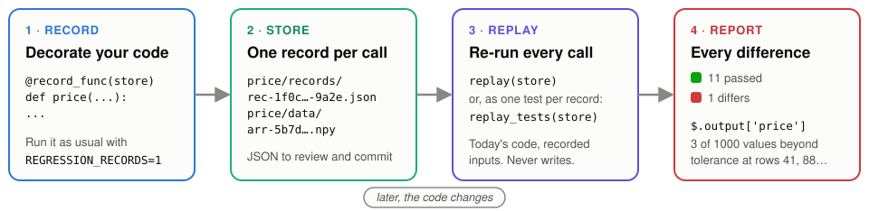
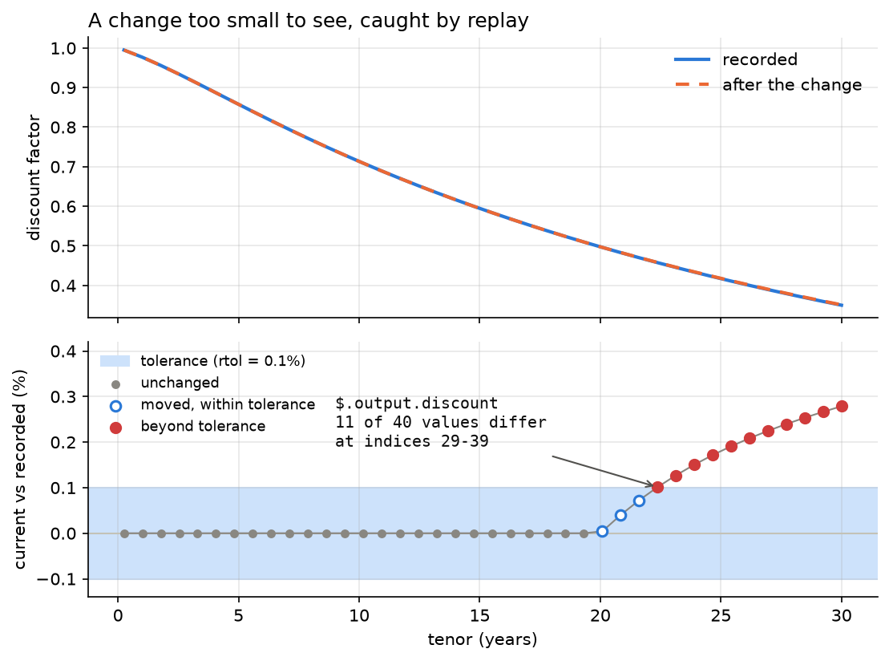

# regression-records

**Record real calls. Replay them as regression tests.**

[](https://github.com/ronaldBuddys/regression-records/actions/workflows/ci.yml)
[](https://ronaldbuddys.github.io/regression-records/)
[](LICENSE)
[](pyproject.toml)



Golden-master testing for code you trust but have no tests for. Decorate it, run it
once with recording on, and from then on every change is checked against what it used
to do: arrays, dataframes and objects included, down to the element that moved.

## Quickstart

```python
# pricing.py
import numpy as np
from regression_records import record_func


@record_func("tests/regression_data")
def discount(tenors: list[float], rate: float) -> np.ndarray:
    return np.exp(-rate * np.asarray(tenors))
```

```bash
# 1. Record: run anything that calls it, with the switch on.
REGRESSION_RECORDS=1 python -c "import pricing; pricing.discount([1, 5, 10, 30], rate=0.03)"
# 2. Change the code: in pricing.py, cap the tenor at 20 years with np.minimum(tenors, 20).
# 3. Replay every recorded call against the code as it is now.
python -c "from regression_records import replay; print(replay('tests/regression_data').summary())"
```

```text
replayed 1 record(s) from tests/regression_data: 1 differs
differs: pricing:discount record 2488b4c8 (pricing/discount/records/rec-82b03c89b625929f-2488b4c8.json)
  code changed since recording (dbb90717f9cdf6d5 -> c15808d759898ce8)
  comparison failed with 1 diff(s):
    at '$.output' (value_mismatch): 1 of 4 element(s) differ beyond tolerance at index/indices: 3
```

In a test suite, one line turns the store into one pytest test per record:
`test_regressions = replay_tests("tests/regression_data")`.

## Too small to see, not too small to catch



*The two curves overlap, and replay names the 11 points beyond tolerance
([catching a regression](https://ronaldbuddys.github.io/regression-records/auto_examples/01_basics/02_catching_a_regression.html)).*

## What it handles

| Value | Recorded as | Compared | Example |
| --- | --- | --- | --- |
| numpy arrays and scalars | `.npy` side file, content-addressed | element-wise, `rtol` / `atol`, dtype and shape checked | [catching a regression](https://ronaldbuddys.github.io/regression-records/auto_examples/01_basics/02_catching_a_regression.html) |
| polars frames and series | `.parquet` side file | per column and cell, schema checked | [dataframes](https://ronaldbuddys.github.io/regression-records/auto_examples/03_what_gets_recorded/11_dataframes.html) |
| pandas frames and series | `.parquet` side file (pickle only if you opt in) | per column and cell, index and schema checked | [dataframes](https://ronaldbuddys.github.io/regression-records/auto_examples/03_what_gets_recorded/11_dataframes.html) |
| your own classes | class path plus attributes, recursively; no registration | attribute by attribute (`$.output.origin.y`) | [custom classes](https://ronaldbuddys.github.io/regression-records/auto_examples/03_what_gets_recorded/09_custom_classes.html) |
| exceptions | type, message and traceback, in place of a return value | by type; the message is deliberately not compared | [exceptions and drift](https://ronaldbuddys.github.io/regression-records/auto_examples/03_what_gets_recorded/08_exceptions_and_drift.html) |
| methods with state | arguments plus `self` before and after the call | return value and `$.state_after` | [recording methods](https://ronaldbuddys.github.io/regression-records/auto_examples/03_what_gets_recorded/07_recording_methods.html) |
| recording runs | a run manifest: packages, commits, your context | read back with `load_manifest` | [run manifests](https://ronaldbuddys.github.io/regression-records/auto_examples/02_workflow/06_run_manifests.html) |
| pytest | - | `replay_tests(store)`: one test per record | [`replay_tests`](https://ronaldbuddys.github.io/regression-records/auto_examples/04_replay_in_practice/14_replay_tests.html) |

All fifteen executed examples, in five sections, are in
[the gallery](https://ronaldbuddys.github.io/regression-records/auto_examples/index.html).

## How it differs

[pytest-regressions](https://github.com/ESSS/pytest-regressions),
[syrupy](https://github.com/syrupy-project/syrupy) and
[ApprovalTests](https://github.com/approvals/ApprovalTests.Python) snapshot a value
inside a test you write. regression-records records the calls your code already makes,
and re-runs them.

| | regression-records | pytest-regressions | syrupy | ApprovalTests |
| --- | --- | --- | --- | --- |
| Where cases come from | real calls, recorded by a decorator | a test per case | a test per case | a test per case |
| What is stored | arguments and result (or exception), plus method state | the value you check | the value's serialized form | received / approved files |
| Checked by | re-running the function on the recorded arguments | re-running your test | re-running your test | re-running your test |
| Float tolerance | `rtol` / `atol`, per function and per path | per check, for numeric and frame fixtures | exact match | exact match |
| Accepting a change | re-record, delete the old record file | `--force-regen` | `--snapshot-update` | approve the received file |

Use those to pin values in tests you are writing anyway. Use this one for code you would
rather not write tests for: a pipeline, a pricing model, a legacy module before a refactor.

## Install

Python 3.11 or later. It is not on PyPI yet; install from git, with the extra for your
frames:

```bash
uv add "regression-records @ git+https://github.com/ronaldBuddys/regression-records"
uv add "regression-records[polars] @ git+https://github.com/ronaldBuddys/regression-records"
uv add "regression-records[pandas] @ git+https://github.com/ronaldBuddys/regression-records"
```

numpy is the only hard dependency.

## Learn more

- **[Documentation](https://ronaldbuddys.github.io/regression-records/)**: start with
  [Getting started](https://ronaldbuddys.github.io/regression-records/getting_started.html),
  then [the examples](https://ronaldbuddys.github.io/regression-records/auto_examples/index.html),
  [replay](https://ronaldbuddys.github.io/regression-records/replay.html),
  [limitations](https://ronaldbuddys.github.io/regression-records/limitations.html) and
  [the API](https://ronaldbuddys.github.io/regression-records/api.html).
- **[SECURITY.md](SECURITY.md)**: loading a store imports the code its records name, so
  never load a store you did not write.
- **[CHANGELOG.md](CHANGELOG.md)**: what changed, including store format versions.
- **[Contributing](docs/building.rst)**: `uv sync --all-extras`, then `uv run pytest` and
  `uv run make -C docs html`.
- **[License](LICENSE)**: MIT.
